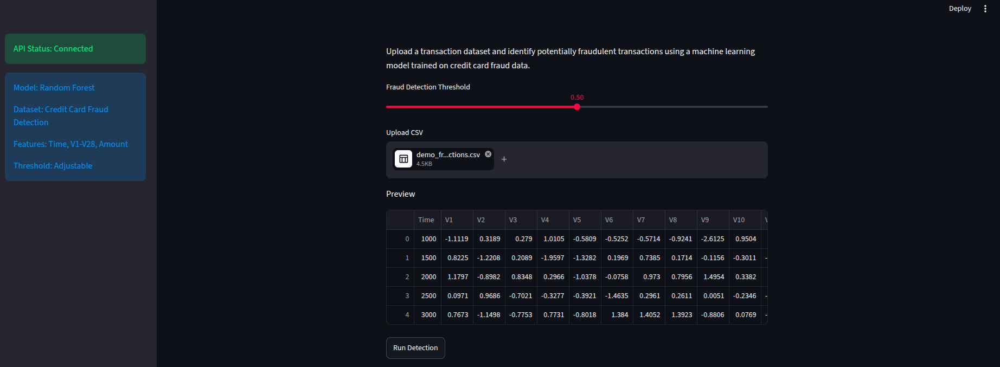
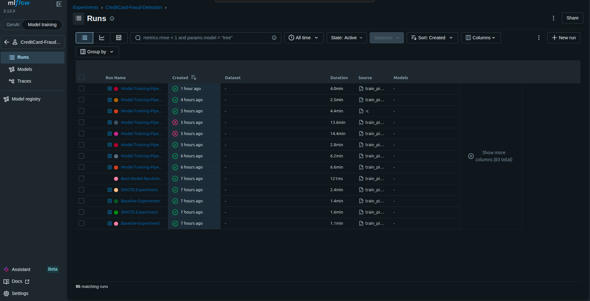
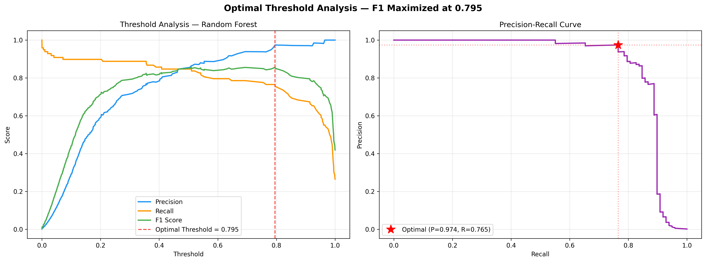
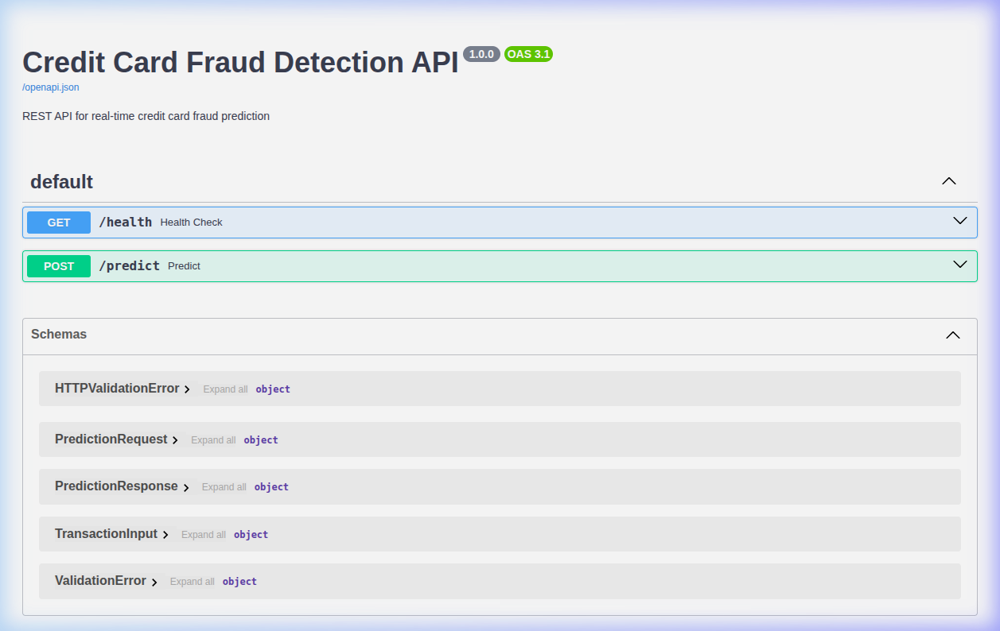

# 💳 Credit Card Fraud Detection

**An end-to-end ML pipeline on highly imbalanced data: ingestion, preprocessing, SMOTE, model comparison with MLflow, threshold selection, a FastAPI prediction service, and a Streamlit analyst dashboard.**


**Live dashboard:** https://transaction-fraud-detector-atzt.onrender.com/
(Render free tier: the first load after idle can be slow.)



## What is deployed

| Component | File | Status |
|---|---|---|
| Streamlit dashboard (CSV upload, threshold slider, risk tiers, CSV download) | `streamlit_app.py` | **Deployed on Render.** Loads the model directly. |
| FastAPI prediction service (`/health`, `/predict`) | `app.py` | Runs locally. Not deployed. |

The dashboard does **not** call the API; both use the same `PredictionPipeline`.

## Dataset

| | |
|---|---|
| Source | [Credit Card Fraud Detection (ULB, Kaggle)](https://www.kaggle.com/datasets/mlg-ulb/creditcardfraud) |
| Size | 284,807 transactions, 0.17% fraud |
| Features | `Time`, `Amount`, and `V1`–`V28` (PCA-anonymised) |
| Split | 80/20 stratified (`random_state=42`): **56,962 test transactions, 98 frauds** |
| Preprocessing | `RobustScaler` on `Time` and `Amount`; SMOTE on the training set only |

## Pipeline

```
Data ingestion → stratified split → RobustScaler → (baseline | SMOTE)
   → train 4 models → MLflow logging → RandomizedSearchCV on Random Forest
   → F1-maximising threshold → save model.pkl + scaler.pkl + metadata.json
```

Models compared, each **with and without SMOTE**: Logistic Regression, Random Forest, XGBoost, LightGBM.

## Results (test set, 98 frauds)

| Model | Setting | AUPRC | Precision | Recall | F1 | ROC-AUC |
|---|---|---:|---:|---:|---:|---:|
| Logistic Regression | Baseline | 0.739 | 0.829 | 0.643 | 0.724 | 0.957 |
| Random Forest | Baseline | 0.873 | 0.941 | 0.816 | 0.874 | 0.963 |
| XGBoost | Baseline | 0.797 | 0.867 | 0.796 | 0.830 | 0.939 |
| LightGBM | Baseline | 0.032 | 0.079 | 0.306 | 0.126 | 0.468 ⚠️ |
| Logistic Regression | SMOTE | 0.725 | 0.059 | 0.918 | 0.111 | 0.971 |
| Random Forest | SMOTE | 0.871 | 0.863 | 0.837 | 0.850 | 0.973 |
| XGBoost | SMOTE | 0.865 | 0.712 | 0.857 | 0.778 | 0.983 |
| LightGBM | SMOTE | 0.775 | 0.491 | 0.867 | 0.627 | 0.944 |
| **Random Forest (SMOTE, tuned) — deployed** | SMOTE | **0.876** | 0.856 | 0.847 | 0.851 | 0.970 |

Deployed model: Random Forest, 200 trees, `min_samples_split=10`, decision threshold **0.795**.
Raw numbers: `artifacts/metrics/*.csv`, `tuning_results.json`.

**What the table says**

- **SMOTE helped the boosting models** (XGBoost AUPRC 0.797 → 0.865, LightGBM 0.032 → 0.775) but **made no real difference for Random Forest**.
- **SMOTE wrecked Logistic Regression's precision** (0.829 → 0.059): lots of false alarms for few extra catches.
- With only **98 frauds** in the test set, differences of 0.002–0.005 AUPRC between Random Forest variants are **noise**, not wins.
- ⚠️ **LightGBM baseline (ROC-AUC 0.468, worse than random) indicates a failed training run**, most likely a configuration problem. It is a known open issue, not a real result.

## Explainability and tracking

- **MLflow** (SQLite backend): parameters, metrics, confusion matrices and artifacts for every run.
- **SHAP** summary and global feature importance (the SHAP plot is computed on XGBoost, not on the deployed Random Forest).
- Precision–recall threshold analysis: `artifacts/metrics/threshold_analysis.png`.

| MLflow | Threshold analysis |
|---|---|
|  |  |

## Run it

```bash
git clone https://github.com/Naman225/transaction-fraud-detector.git
cd transaction-fraud-detector
python -m venv venv && source venv/bin/activate
pip install -r requirements.txt

# train (needs data/creditcard.csv or a Kaggle download)
python -m src.pipeline.train_pipeline

# experiment tracking UI
mlflow ui --backend-store-uri sqlite:///mlflow.db

# dashboard
streamlit run streamlit_app.py

# API
uvicorn app:app --reload        # docs at http://127.0.0.1:8000/docs
```

Example request:

```json
POST /predict
{ "threshold": 0.795,
  "transactions": [ { "Time": 0, "V1": -1.36, "...": 0, "V28": -0.02, "Amount": 149.62 } ] }
```



## Project structure

```
app.py                  FastAPI service
streamlit_app.py        Streamlit dashboard
render.yaml             Render deployment (dashboard)
src/components/         data_ingestion, data_transformation, model_training
src/pipeline/           train_pipeline, prediction_pipeline
src/utils/              logger, save_object
artifacts/              metrics (CSV, JSON, plots) and model files
eda.ipynb               exploratory analysis
```

## Known limitations

- **Selection and tuning used the test set.** Model choice, hyperparameter search results and the F1-maximising threshold were all evaluated on the same held-out test set (no separate validation set), so reported numbers are optimistic.
- **Hyperparameter search ran on a SMOTE-resampled sample**, which leaks synthetic neighbours across CV folds (the logged CV AUPRC of 0.9999 is an artefact; ignore it).
- Only 98 frauds in the test set means wide uncertainty on every metric.
- The data is anonymised 2013 European card data. It says nothing about current fraud patterns, and there is no drift monitoring.
- The API default threshold is 0.5, while the tuned threshold (0.795) is only the Streamlit default.
- No authentication or rate limiting on the API. `model.pkl` (31 MB) is committed to Git.

## Next steps

- Proper train/validation/test split or nested CV, with SMOTE inside an `imblearn` pipeline
- Choose the threshold from business cost (missed fraud vs false alarm), with bootstrap confidence intervals
- Probability calibration; fix or drop the LightGBM baseline
- Dockerfile, CI, and let the dashboard call the API

## Author

Built by [Naman Tiwari](https://github.com/Naman225).
